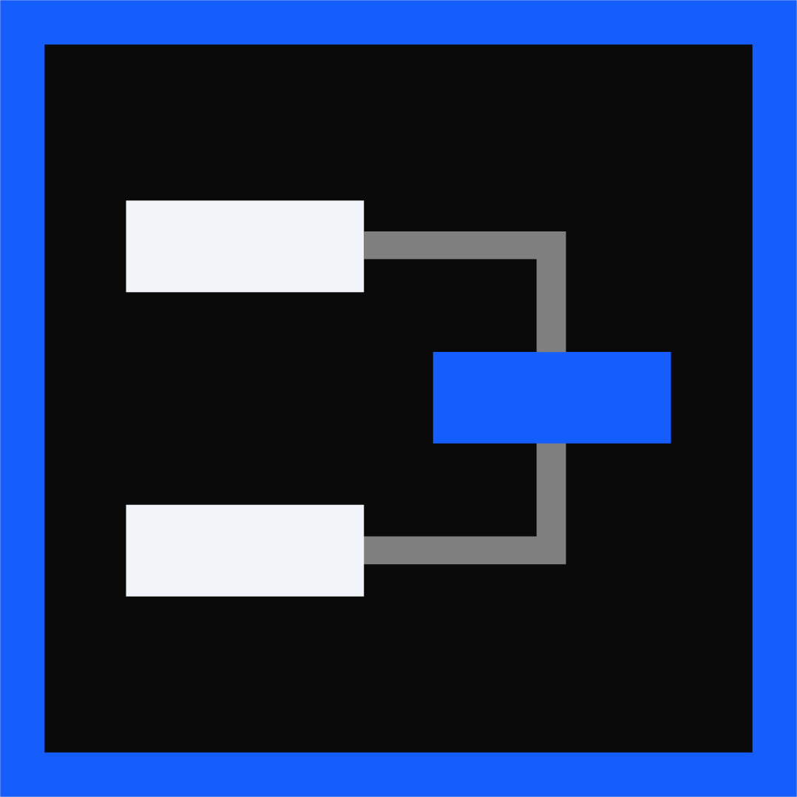

<h4 align="center">🌐<a href="/README.md">English</a> | <a href="/README-RU.md">Русский</a>

<p align="center">  </p>
<p align="center">  </p>

<p align="center">
    <b> A universal toolkit to simplify tournament organization. </b>
</p>
<p align="center">
    <a href="https://pkg.go.dev/github.com/dreamervulpi/tourney-helper"></a>
    <a href="https://github.com/DreamerVulpi/tourney-helper/releases"></a>
    <a href="https://dreamervulpi.github.io/tourney-helper-website/"></a>
    <a href="./LICENSE"></a>
    <a href="https://github.com/DreamerVulpi/tourney-helper/issues"></a>
</p>
<p align="center">
    <a href="https://ko-fi.com/dreamervulpi"></a>
    <a href="https://boosty.to/dreamervulpi"></a>
</p>

## 💡 Features

### Current version ```0.5.0```
* Support for retrieving data from the [start.gg](https://www.start.gg/) tournament platform;
* Support for sending messages via [Discord](https://discord.com/);
* Support for retrieving game IDs for the following games: Tekken 8 and Street Fighter 6;

### 📨 Automated Notification System for Tournament participants
* Support for retrieving data from the [start.gg](https://www.start.gg/) tournament platform;
* Support for sending messages via [Discord](https://discord.com/);
* Support for retrieving game IDs for the following games: Tekken 8 and Street Fighter 6;
* Supported tournament types: Single (1-on-1);
* Supported tournament formats: Single | Double Elimination (up to one | two losses);
* Notifications are sent once every 5 minutes;
* The matchmaking speed is ```50–60 players per ~1 minute*```, including player search and saving to a local database.
    * *depending on the stability of your device’s connection to the platforms;
* The following metrics are displayed during matchmaking:
    * load with request rates per second/minute for each platform;
    * time (ms) per request;
    * time (ms) remaining until the end of the broadcast cycle, which is calculated in real time and corresponds to actual processing;
* The system determines:
    * who to send notifications to based on data from the tournament bracket and its local database;
    * in which language to send messages to the player (the default is English, but Russian can be selected. Role IDs will be required if your event includes players who speak different languages);
    * which matches are played independently by players and which will be live-streamed—corresponding messages are sent;
* Thanks to the bot, the notification system allows you to retrieve a player's contact information directly from local storage via the messenger using the following command: ```/contact [in-game_nickname] [game_name]```

### 🗃️ Local player database
* Built-in search by in-game nicknames, contact usernames, or region;
* Automatic addition of players to the database from results found by the notification system;
* Ability to manually add players or import them via CSV or JSON files (using a template) into the database or ban list;
* Ability to copy a single player’s contact information in text format with one click to send to someone;
* Full control over data: Create, edit, delete, ban, and unban users;
* Support for your own ranking league with the ability to reset all players’ rankings with a single click;
* Support for a ban list with automatic removal of bans upon expiration;

### 🏆 Bracket Widget
* Displays the tournament bracket based on supported integrations;
* Hovering over a player displays their progress path;
* Displaying matches for live broadcasts;
* You can customize the zoom level, type, and display style of the bracket in real time;
* Support for custom themes (a sample file is located in `widgets/bracket/themes/startgg.css`);
* Each generated link operates based on the source data independently of the others (settings apply to all links);

### 👥 Profile and Integration System
* Ability to create, duplicate, export, and import pre-configured settings for all widgets and tools, including authentication;
* When selecting an OAuth client, only available integrations are displayed to avoid overloading the API;
* Each profile offers 5 slots for each integration, ensuring flexibility and ease of use;
* When one of the widgets or tools is launched, the system blocks access to the profile to prevent accidental data corruption;

## 🚀 Getting Started
1. Download the archive of the latest version from the "Releases" tab.
2. Extract it to a convenient folder.
3. Run ```TourneyHelper.exe```
<p>
   The necessary instructions and tips are available within the program itself when you click the "Help" button.
</p>

## 🗺️ Roadmap

Project Plans and Details [on the website.](https://dreamervulpi.github.io/tourney-helper-website/)

## 📄 License

This project is licensed under the [MIT](./LICENSE) License.

© 2026 DreamerVulpi